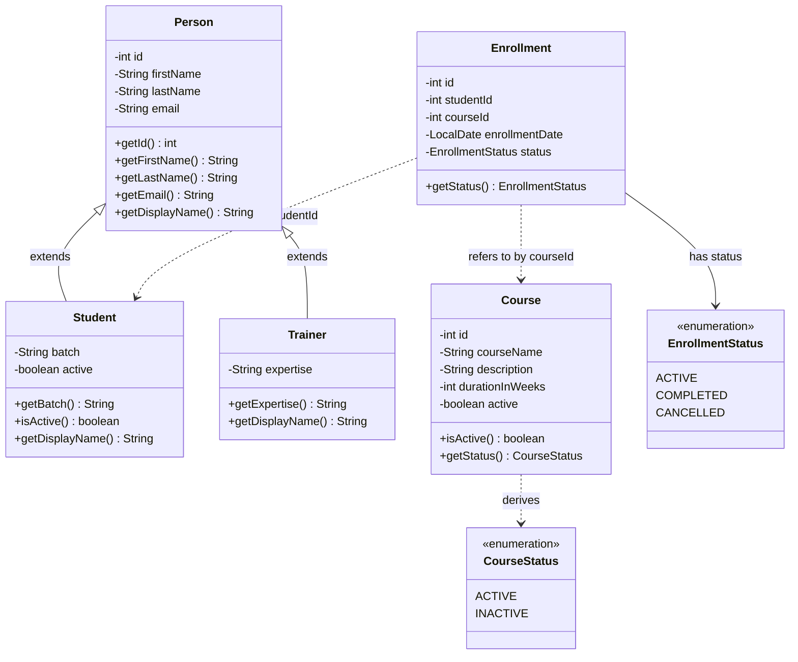
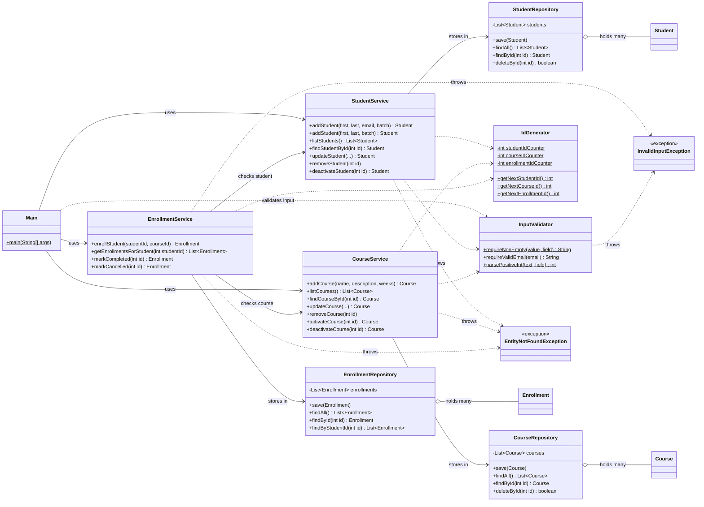

# LearnTrack - Student & Course Management System

LearnTrack is a console-based, menu-driven application built with **Core Java**. An admin can manage
**students**, **courses** and **enrollments**. All data is kept in memory (`ArrayList`), so it resets
every time the program stops.

## Features

- **Students:** add, view all, search by ID, deactivate (soft delete)
- **Courses:** add, view all, activate / deactivate
- **Enrollments:** enroll a student in a course, view a student's enrollments, mark as completed / cancelled
- Friendly error messages for invalid menu options, bad numbers, empty fields and unknown IDs

## Project structure

```
src/com/airtribe/learntrack/
├── Main.java            # menu + console input only
├── entity/              # Person, Student, Trainer, Course, Enrollment
├── repository/          # in-memory storage (ArrayList)
├── service/             # business logic
├── exception/           # EntityNotFoundException, InvalidInputException
├── util/                # IdGenerator, InputValidator
├── constants/           # MenuOptions, AppConstants
└── enums/               # EnrollmentStatus, CourseStatus
docs/                    # Setup_Instructions.md, JVM_Basics.md, Design_Notes.md
```

## Class diagram

The diagrams below are written in [Mermaid](https://mermaid.js.org/), which GitHub renders automatically in this README.

### 1. Entities and enums

`Student` and `Trainer` inherit from `Person`. An `Enrollment` links a student and a course by their IDs (`studentId`, `courseId`) instead of holding the objects, which keeps the entities simple.



### 2. Layers: UI, services, repositories and helpers

`Main` talks only to the services. Services hold the business rules and use repositories for storage. `EnrollmentService` also uses `StudentService` and `CourseService` to check that IDs exist.



**Reading the arrows:** `<|--` is inheritance, `-->` means "uses / has a reference to", `o--` means "holds a collection of", and `..>` is a weaker dependency (a helper is called or an exception is thrown).

## Requirements

- JDK 11 or newer (tested with JDK 21)

## How to compile and run

From the project root (the folder containing `src/`):

**Linux / macOS**
```bash
mkdir -p out
javac -d out $(find src -name "*.java")
java -cp out com.airtribe.learntrack.Main
```

**Windows (PowerShell)**
```powershell
mkdir out
javac -d out (Get-ChildItem -Recurse -Filter *.java src | ForEach-Object FullName)
java -cp out com.airtribe.learntrack.Main
```

**IDE (IntelliJ / Eclipse / VS Code):** open the folder, mark `src` as the source root and run
`com.airtribe.learntrack.Main`.

## Sample session

```
---- MAIN MENU ----
1. Student Management
2. Course Management
3. Enrollment Management
0. Exit
Choose an option: 1
...
Student added: Student{id=1, name=Asha Rao, email=asha@mail.com, batch=B1, active=true}
```

## Documentation

- [Setup Instructions](docs/Setup_Instructions.md)
- [JVM Basics](docs/JVM_Basics.md)
- [Design Notes](docs/Design_Notes.md)
